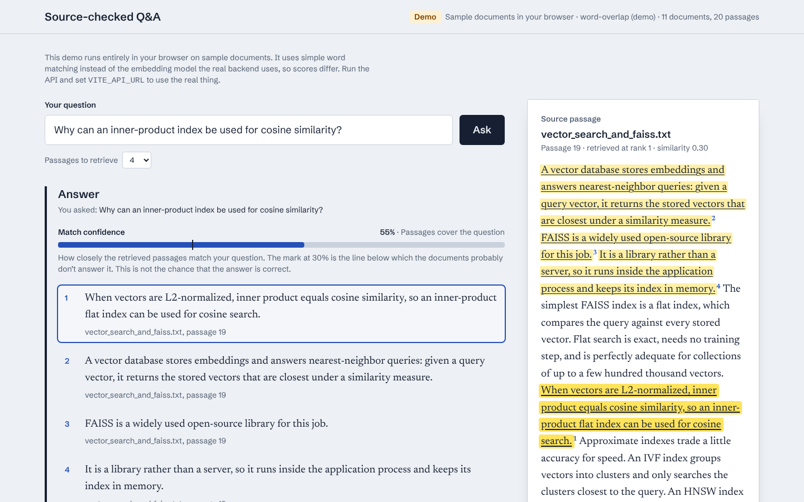
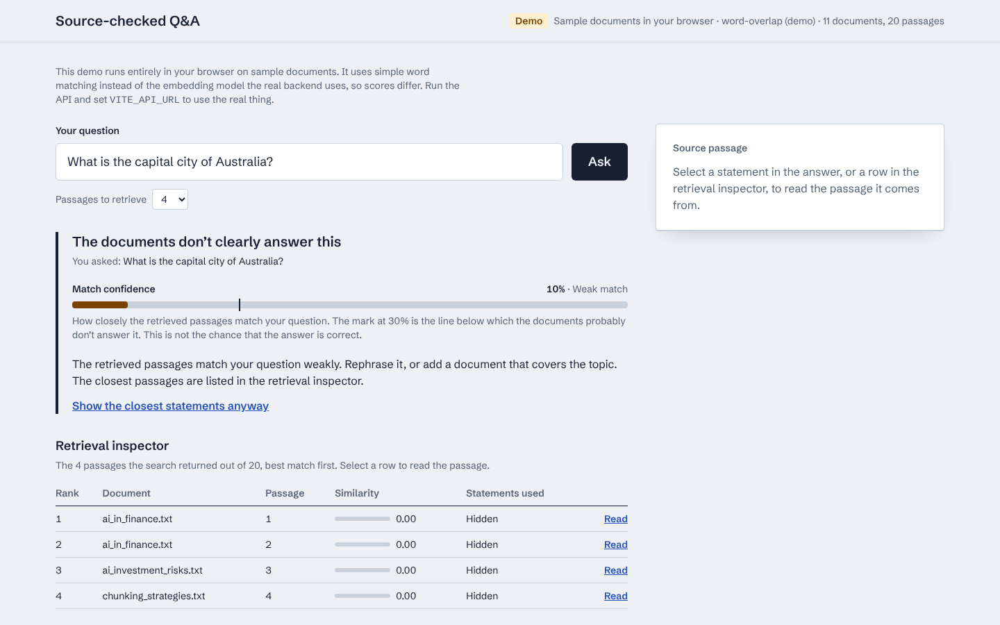
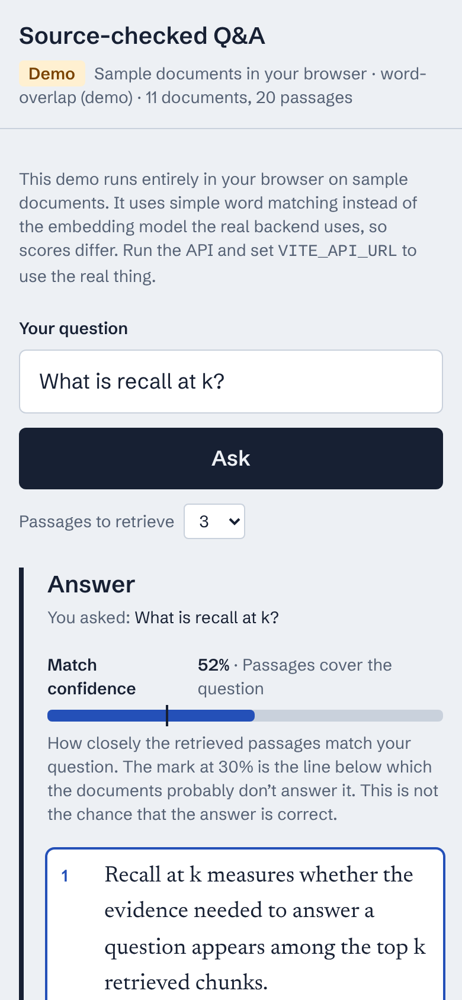

# Source-checked Q&A

Ask a question about your documents and check every part of the answer against the passage it came from.

AI answers are hard to verify. This interface puts the evidence next to the answer: each statement is numbered, and selecting one highlights the exact sentence in its source passage. When the documents don't answer the question, it says so instead of showing a confident-looking guess.



| When the documents don't answer | On a phone |
|---|---|
|  |  |

## What it does

- Answers a question and lists the statements of the answer, each tied to a source passage, with the cited sentence highlighted in the passage.
- Shows a match confidence meter with the line below which the documents probably don't answer the question.
- Switches to a "the documents don't clearly answer this" state below that line. The closest statements stay hidden until you ask to see them, and no passage is marked as a source until then.
- Has a retrieval inspector: every passage the search returned, with its document, similarity score and how many statements used it.
- Lets you upload `.txt` and `.pdf` files and remove them. An answer that was made before the documents changed is flagged as out of date.
- Keeps the question in the address bar (`?q=` and `?k=`), so an answer can be shared as a link. Each question is its own history entry, so the browser's Back and Forward buttons step between questions. Clear starts over.

## Run it

You need Node 22.12 or newer. Use an even-numbered release (22 or 24); odd-numbered releases such as 25 are not supported by the test runner.

```bash
npm install
npm run dev:demo      # sample documents, no server needed
```

**Demo mode** runs a small search engine in the browser over the sample documents. It uses word matching instead of the embedding model the real service uses, so its scores are on a different scale and it reads `.txt` files only.

To use the real backend ([ai-research-assistant-rag](https://github.com/hetanshigithub/ai-research-assistant-rag)):

```bash
# in the backend repo
docker compose up --build

# in this repo
npm run dev           # reads VITE_API_URL=http://localhost:8000 from .env.development
```

The backend allows requests from `http://localhost:5173` by default. For another address, set `CORS_ORIGINS` on the backend.

A production build (`npm run build`) has no API address, so it runs in demo mode. Set `VITE_API_URL` at build time to point it at a hosted backend.

### Deploy to Vercel

Import the repository, keep the Vite defaults (build command `npm run build`, output directory `dist`) and deploy. With no environment variables it deploys in demo mode.

## How it works

```
src/
  api/        Api interface, live HTTP client, typed errors
  demo/       in-browser stand-in for the backend, with the sample documents
  features/
    ask/        question form, answer, confidence meter, source panel, retrieval inspector
    documents/  document list, upload, removal
  lib/        highlighting and formatting helpers
```

The interface only talks to an `Api` interface (`query`, `getIndex`, `listDocuments`, `uploadDocument`, `deleteDocument`). `createLiveApi` implements it over `fetch`, and `createDemoApi` implements it in memory. Tests and the deployed demo use the same components as the live version.

- **Citations are exact.** The backend copies sentences out of the retrieved text and returns the character range of each one (`citations[].start` and `end`). The interface highlights those ranges as given. A statement that can't be found word for word is shown as "Source passage not located" and is not guessed at.
- **Server state** (documents, index information, answers) is handled with TanStack Query. The selected statement and passage are plain component state.
- **Errors** are typed (`ApiError` with an HTTP status) and the messages the API sends are shown as they are, for example "A document named x.txt already exists."

## Tests

```bash
npm run test:run    # 56 tests
npm run typecheck
npm run lint
```

The tests cover the highlight helper, the HTTP client (error mapping, upload and delete requests), the demo search engine (including that every statement's location is exact), and the interface (asking, selecting statements, the weak-match state, the retrieval inspector, errors and retry, uploading, removing, and the out-of-date notice).

Accessibility: axe rules run in the test suite on the empty, answered and weak-match screens. Colour contrast can't be checked without a real browser, so the palette's text colour pairs were measured separately (at least 4.5:1 in light and dark mode). Nothing here has been tested with a screen reader.

## Limits

- The confidence meter measures how closely the retrieved passages match the question. It is not the probability that the answer is right. The 0.5 line in the backend comes from its evaluation set and has false alarms: on that set it flagged 2 of 30 answerable questions.
- The answers are extractive: every statement is a sentence from the documents, so an answer can be a poor summary even when each statement is real.
- Uploading rebuilds the whole index. That is quick for small collections and would not scale to large ones.
- There is no sign-in. Anyone who can reach the backend can upload or remove documents.
